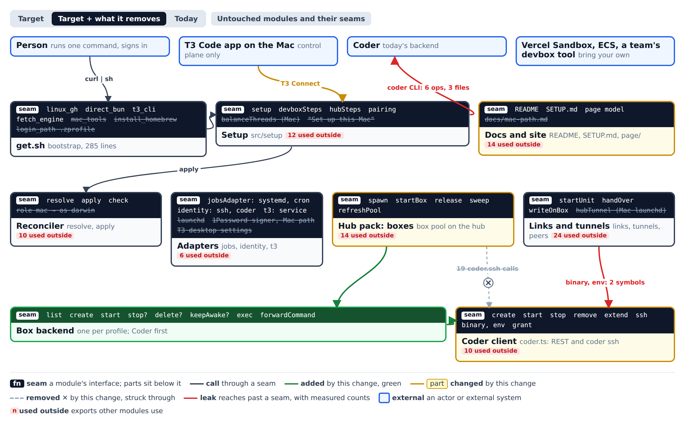
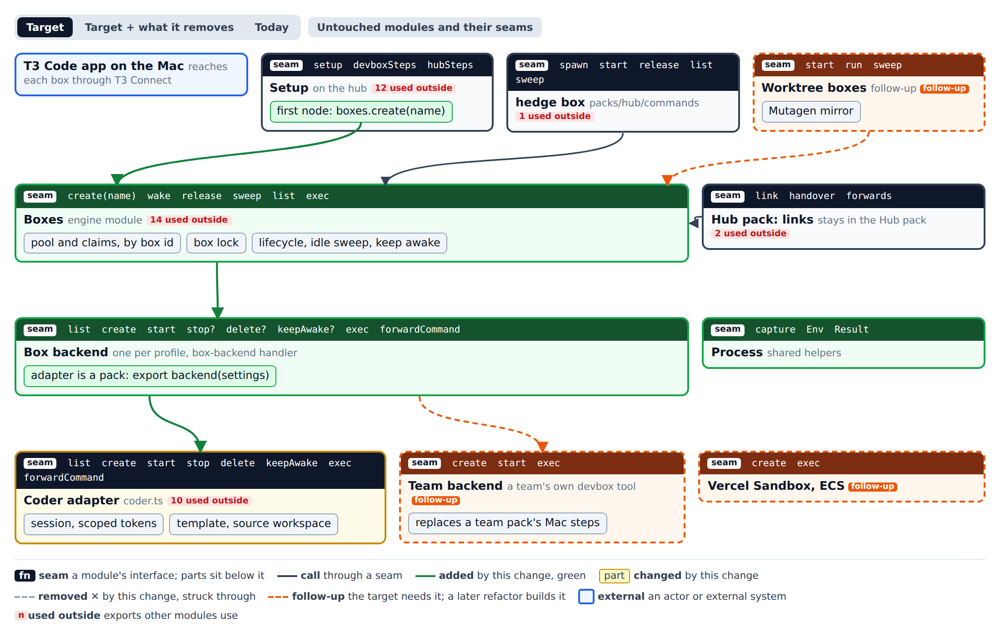
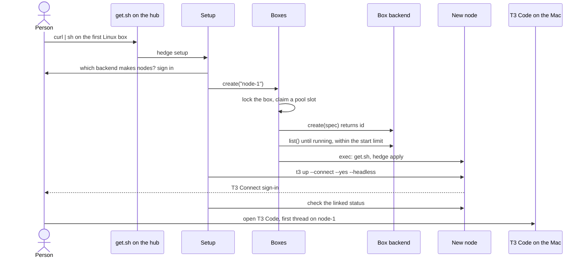
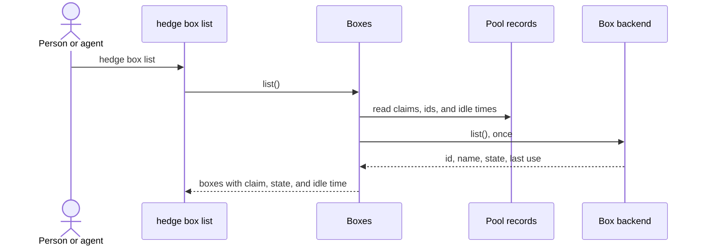
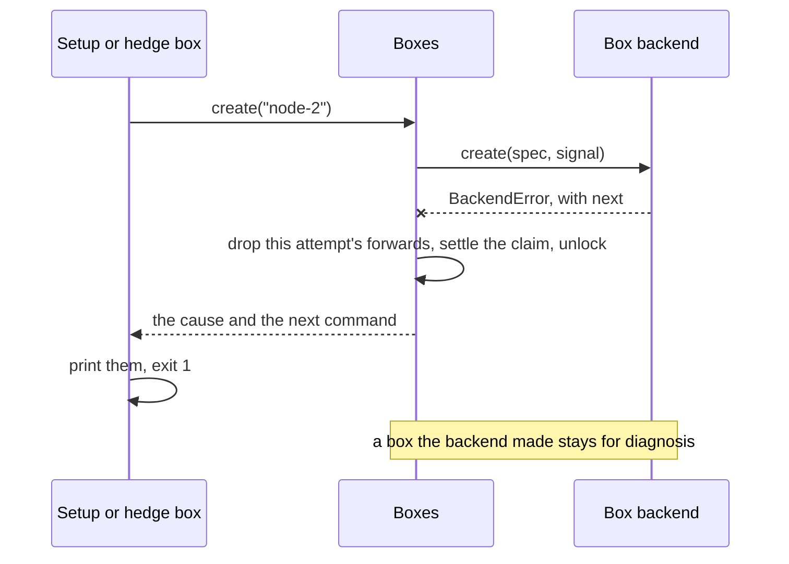

# Hedge refocus: cloud boxes only, and a Box backend seam

Status: proposed, 2026-11-20. The cloud-only part ships in
[#284](https://github.com/PostHog/hedge/pull/284). This spec adds the Box
backend seam and the slices that build it.

## The question

Hedge must do one thing well: run coding agents on Linux boxes that stay on,
and let a person steer them from T3 Code on a Mac or a phone. Two parts of
the engine work against that focus:

1. **The Mac path.** The `mac` role, the launchd adapter, the hub tunnel, the
   Mac path of the 1Password signer, and T3 desktop settings exist only to
   set up a Mac. #284 stops `get.sh` from installing on a Mac, but this code
   is still there.
2. **Boxes come only from Coder.** `hedge devbox add <ssh host>` already
   adds any Linux machine that a person brings. But a box that Hedge
   creates, starts, stops, and sweeps comes only from Coder. The box pool,
   setup, and the links call the Coder CLI directly: 19 `coder.ssh` calls
   outside `coder.ts`, 6 Coder CLI operations in 3 setup files, and
   `capture`, `Env`, and `Result` imported from `coder.ts` by 13 files. A
   team with Vercel Sandbox, ECS, or its own devbox tool cannot plug it in.

The decisions:

- The Mac runs nothing from Hedge. It runs only the T3 Code app and reaches
  the boxes through T3 Connect ([ADR 0001](../adr/0001-mac-runs-only-t3-code.md)).
- A profile selects one Box backend: a pack that provides the `box-backend`
  handler ([ADR 0002](../adr/0002-box-backends-are-packs.md)). The `coder`
  pack ships with the engine.
- Boxes is one engine module, and the only caller of the backend
  ([ADR 0003](../adr/0003-boxes-is-the-only-backend-caller.md)).
- A backend failure is never retried in silence
  ([ADR 0004](../adr/0004-no-silent-backend-retry.md)).
- The target is a first thread in under 10 minutes on a fresh account,
  with under 60 seconds of machine work.
- It ships as one breaking release. Profiles drop their Mac machine, and
  team packs drop their darwin items.

### Out of scope

- A Mac workstation setup, and a Cursor adapter.
- More than one backend in a profile, or a pool that mixes backends.
- A backend without SSH access, or one whose boxes expire while a thread
  runs, such as a short-lived sandbox. The Vercel Sandbox and ECS follow-ups
  must solve this first.
- Image or template choice across backends. Each adapter keeps its own, such
  as the Coder template and source workspace.
- Moving worktree boxes onto Boxes, and splitting the Hub pack. Both are
  follow-ups.

## Rung 1: the system

[rung1.html](hedge-refocus/rung1.html) is the full page, with Target, Target
plus what it removes, and Today. "Today" is `main` before #284.



- The person runs one command on a Linux box. The Mac only signs in to T3
  Connect.
- Struck through: everything that sets up a Mac.
- Red: the leaks into Coder that the Box backend seam closes.

## Rung 2: the modules

[rung2.html](hedge-refocus/rung2.html) is the full page.



- **Boxes** takes the box pool, the claims, the box lock, the lifecycle,
  the idle sweep, and keep-awake from the Hub pack. These are the parts that
  setup and `hedge box` both use.
- The T3 link, the Claude handover, the gateway setup, and the peer
  forwards stay in the Hub pack. They call Boxes.
- **Box backend** is the seam. The adapter is a pack that exports one
  `backend` function.
- **Process** holds `capture`, `Env`, and `Result`, which move out of
  `coder.ts` with their deadlines.
- Orange frames are follow-ups.

## Contracts

```ts
type BoxState = "running" | "starting" | "stopped" | "failed";

class BackendError extends Error {
  next?: string;
}

type BoxBackend = {
  list(): Promise<Array<{ id: string; name: string; state: BoxState; lastUsedAt?: number }>>;
  create(spec: { name: string; diskGigabytes: number }, signal: AbortSignal): Promise<{ id: string }>;
  start(id: string, signal: AbortSignal): Promise<void>;
  stop?(id: string, signal: AbortSignal): Promise<void>;
  delete?(id: string, signal: AbortSignal): Promise<void>;
  keepAwake?(id: string, until: number): Promise<void>;
  exec(id: string, command: string, options?: { stdin?: string; inherit?: boolean; afterStartup?: boolean; signal?: AbortSignal }): Promise<Result>;
  forwardCommand(id: string, forward: { remote?: number[]; local?: Array<[number, number]> }): { argv: string[]; env: Env };
};

export function backend(settings: unknown): BoxBackend;

type Boxes = {
  create(name: string): Promise<Box>;
  wake(name: string): Promise<Box>;
  release(name: string, options?: { force?: boolean }): Promise<void>;
  list(): Promise<Box[]>;
  sweep(): Promise<SweepReport>;
  exec(name: string, command: string, options?: { inherit?: boolean }): Promise<Result>;
};
```

- `backend` is the export of the `box-backend` handler module. The pack
  lists it in its handlers, as the `secret-rows` handler does today. The
  resolver already allows one handler for each seam, so one profile has one
  backend. Setup and the pack commands read the same resolved handler.
- The pool keeps each box's `id` from `create` and `list`, and calls the
  backend by `id`. A box that a backend replaced under the same name has a
  new `id`, and Boxes sees it.
- `exec` with `inherit` runs `hedge box run` with the person's terminal.
  `afterStartup` waits for the box's startup scripts, as
  `coder ssh --wait=yes` does today.
- `forwardCommand` returns the command and the environment for a forward
  that runs as a systemd user unit, such as the reverse forwards to the hub
  and the T3 forward. It replaces `startUnit`'s use of `binary` and `env`.
- `keepAwake` replaces the Coder deadline extension that the sweep uses for
  a busy box.
- A machine that `hedge devbox add` added has no backend. Boxes reaches it
  over SSH and never creates, starts, or stops it.

### Invariants

- The hub holds one lock per box name.
- A failed `create` or `wake` drops the forwards that the attempt made and
  settles its claim. The box stays for diagnosis.
- `hedge box list` calls the backend's `list` once. A command that changes a
  box reads its state fresh before it acts.
- Each call keeps today's Coder deadline, such as the 10 minutes for a
  Coder request and the 5 minutes for a start.
- The engine checks at pack load that the handler exports `backend`, and
  that the backend has the required operations.
- No command repeats a backend call in silence.

### Errors

A backend throws a `BackendError` with the cause in its message and, where
one exists, the command that fixes it in `next`. Boxes prints both and
exits 1. When the cause is a quota, `next` names `hedge box sweep`. When a
create or a start fails, Boxes keeps the box for diagnosis, as it does
today, and names `hedge box release <name> --delete`.

The spawn stopwatch keeps logging each spawn to
`~/.local/state/hedge/box-spawn.jsonl`, as it does today.

### Limits

- T3 Connect limits how many machines one account links. When setup links a
  box and T3 Code reports that the limit is reached, setup prints the reason
  that T3 Code gives and how to free a machine, as it does today.

## Call paths

### Write: setup on the hub makes the first node



### Read: `hedge box list`



### Failure: the backend refuses or times out



## Thin slices

Each slice is one PR that a person can use on its own.

1. **Cloud only.** Done in [#284](https://github.com/PostHog/hedge/pull/284):
   `get.sh` installs nothing on a Mac and stops old Mac jobs, the site
   promises cloud boxes only, and setup signs the hub in to T3 Connect.
2. **Delete the dead Mac code.** The `mac` role and the `darwin` OS, the
   launchd install code, the hub tunnel and `hub-https-trust`, the Mac path
   of the 1Password signer, T3 desktop settings, the Codex darwin step, the
   Mac branch of `balanceThreads`, the hub pull for a Mac, and the Mac setup
   parts of `docs/mac-path.md`. Keep the Linux 1Password signer and the
   stop-only cleanup of old Mac installs in `get.sh`.
3. **Process, the Box backend seam, and the `coder` pack.** No change in
   behavior. The box tests run through the seam, with a fake backend beside
   the Coder one.
4. **`hedge devbox add` through Boxes.** Its Coder CLI calls move into the
   Coder adapter, and plain SSH hosts keep working as they do today.
5. **Setup makes the first node through the backend.** Setup's usable
   milestone and the spawn stopwatch measure it. A fresh-account proof
   measures the time to the first thread.

## Follow-ups

| Follow-up | Strength |
| --- | --- |
| A team backend pack for a team's own devbox tool, which replaces that team pack's darwin steps. When the tool has its own sign-in and setup check commands, the pack calls them in place of Hedge's sign-in steps | Strong: the second adapter of the seam |
| Worktree boxes on Boxes | Strong: one lifecycle and one sweep for all boxes |
| Vercel Sandbox and ECS adapters | Medium: wait for a person who asks, and solve the SSH and expiry limits first |
| Split the Hub pack into engine modules | Bold: the hub becomes an engine concept, as `docs/architecture.md` proposes |

## Further notes

### Complexity

- `forwardCommand` and `exec` with `inherit` and `afterStartup` stay in the
  seam: the hub forwards, `hedge box run`, and the post-start checks use
  them today.
- `stop`, `delete`, and `keepAwake` are optional. Method presence is the
  capability, so the seam has no capability set.
